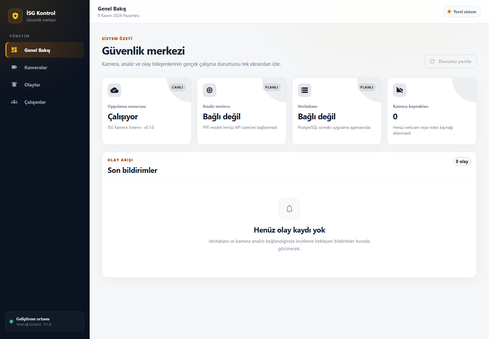

# İSG Kamera Sistemi

Kamera görüntülerinden kişisel koruyucu ekipman kullanımını değerlendiren ve
olayları İSG görevlisinin incelemesine sunan bitirme projesi.

## Şu an çalışan bölüm

- FastAPI sunucusu ve sunucu çalışma durumu adresi.
- Kamera ve içinde bulunulan bölgelerin ekipman şartlarını birleştiren kural kodu.
- Ekipman gözlemini `uygun`, `ihlal adayı` veya `değerlendirilemiyor` olarak ayırma.
- Bu davranışları doğrulayan testler ve bilgisayar ortamını raporlayan araç.
- RTX 3050 Ti üzerinde doğrulanan CUDA destekli PyTorch ve Ultralytics ortamı.
- ZIP içindeki tek görüntüde yerel genel YOLO ağırlığıyla çalışan çıkarım betiği.
- Benzer kareleri bölmeden temiz eğitim/doğrulama/test verisi hazırlama aracı.
- Tüm görüntüleri görsel denetlenen, iş yeri dışı sahneleri çıkarılmış altı sınıflı
  temiz PPE çalışma verisi.
- Temiz veriyle eğitilmiş PPE modeli ve 107 ayrı test görüntüsündeki sayısal rapor.
- Kayıtlı videoyu kaynak zamanında, her açılışta ayrı oturum kimliğiyle okuyan akış.
- Webcam'i ayrı oturumla açan ve bağlantı/okuma durumlarını açıkça bildiren kaynak.
- ByteTrack ile oturum içi insan takibi ve belirsizliği koruyan ekipman–kişi eşleştirmesi.
- Analiz yavaşladığında eski kareleri düşüren sınırlı kuyruk ve donma/güncellik durumu.
- RTX 3050 Ti için ölçülmüş en fazla iki eşzamanlı yerel kaynak sınırı.
- Gerçek FastAPI durumuna bağlı React tabanlı İSG kontrol paneli.
- Argon2id parola özeti, sunucuda tutulan HttpOnly oturum, CSRF ve yönetici/İSG
  rol denetimi.
- Kamera ve çalışan ekleme/düzenleme/pasifleştirme API'leri; türüne göre güvenli
  webcam ve kayıtlı video kaynağı doğrulaması.
- Kamera temeli ile normalize çokgen bölgeleri doğrulayan, eski olayların bağlı
  olduğu sürümü değiştirmeyen kamera kuralı API'leri.
- Ad/numara/bölüm aramalı çalışan listesi; otomatik bağlanmış olay geçmişi ve
  bekleyen/doğrulanmış/yanlış alarm özet API'leri.

İlk filtresiz PPE eğitimi veri setindeki alakasız sahneleri ortaya çıkardı ve
proje modeli olarak reddedildi. 300 iş yeri dışı görüntü ile belirsiz/uygunsuz
eksiklik sınıfları çıkarıldı. Temiz model, eğitimde görmediği 107 görüntüde
mAP50 0,8536 ve yaklaşık 26 FPS verdi. Bu sonuç gerçek fabrika kamerasında saha
onayı yerine geçmez.
İlk web paneli, PostgreSQL çekirdek şeması ve yönetim API'leri hazırdır; zamansal
olay üretimi ve bildirim akışı sonraki adımlardır. Kural testleri model doğruluğu ölçümü olarak
yorumlanmamalıdır.

## Kurulum (Windows / PowerShell)

Ön koşul: Python 3.12. Terminali bu deponun kökünde aç:

```powershell
python -m venv .venv
.\.venv\Scripts\python.exe -m pip install -r backend/requirements-dev.lock.txt
.\.venv\Scripts\python.exe -m pip install -r backend/requirements-database.lock.txt
.\.venv\Scripts\python.exe -m pip install -r backend/requirements-security.lock.txt
.\.venv\Scripts\python.exe -m pip install --no-deps -e ./backend
```

`requirements-dev.lock.txt`, `requirements-database.lock.txt` ve
`requirements-security.lock.txt`, Python 3.12 / Windows üzerinde doğrulanan
sunucu, test, PostgreSQL ve parola güvenliği paketlerinin sürümleridir.
GPU/model ortamı ayrı kurulur:

```powershell
# İlk dosya yaklaşık 2,75 GB PyTorch paketi indirir.
.\.venv\Scripts\python.exe -m pip install -r backend/requirements-torch-cu128.txt
.\.venv\Scripts\python.exe -m pip install -r backend/requirements-vision.lock.txt
```

Bu CUDA listesi NVIDIA ekran kartlı Windows bilgisayar için doğrulandı. Büyük
paketleri indirmeden önce bağlantı ve boş disk alanı kontrol edilmelidir.
Bağımlılıkları güncellerken testleri yeniden çalıştıracağız.

Ortamı etkinleştirme komutu gerekmez; `.venv` içindeki Python'u doğrudan
kullanmak PowerShell betik çalıştırma ayarını değiştirmeden ilerlememizi sağlar.
Sistem Python'una proje paketleri kurulmaz.

İsteğe bağlı ayarlar için `.env.example` dosyasını `.env` adıyla kopyalayabilirsin.
Başlangıç ayarlarıyla bu dosya olmadan da çalışır.
Veritabanı şifresi Git'e girmez. Yerel Windows kurulumunda
`ISG_DATABASE_PASSWORD` kullanıcı ortamında tutulur; başka kurulumlarda Git'in
dışladığı `.env` dosyası kullanılabilir. Şifre eksikse uygulama veritabanını hazır
göstermez ve paket/sunucu indirmeye çalışmaz.

## Çalıştırma

### Tek tıkla başlatma

Windows'ta depo kökündeki `PROJEYI_BASLAT.cmd` dosyasına çift tıkla. Betik
PostgreSQL, FastAPI ve React süreçlerini arka planda başlatır, gerçek veritabanı
bağlantısını doğrular, bekleyen Alembic migration'larını uygular, iki HTTP adresini
kontrol eder ve ardından paneli varsayılan tarayıcıda açar. Tüm proje süreçlerini
kontrollü kapatmak için
`PROJEYI_DURDUR.cmd` dosyasına çift tıkla.

Başlatıcı paket indirmez. `.venv` veya `frontend/node_modules` eksikse hangi
kurulum adımının gerektiğini Türkçe hata mesajıyla bildirir. Çalışma logları
Git dışında tutulan `data/runtime/` klasörüne yazılır.

### İlk yönetici hesabı

Projede varsayılan kullanıcı veya parola yoktur. PostgreSQL çalışırken ilk ve
yalnız ilk yönetici şu komutla oluşturulur; parola terminalde görünmez ve komut
geçmişine yazılmaz:

```powershell
.\.venv\Scripts\python.exe scripts/create_initial_admin.py `
  --username emin `
  --display-name "Emin Bozkurt"
```

İlk kullanıcı oluşturulduktan sonra yeni yönetici/İSG hesapları yalnız yetkili
yönetici API'sinden eklenir. Ayrıntılar
[kimlik doğrulama ve yetki belgesindedir](docs/KIMLIK_DOGRULAMA_VE_YETKI.md).

### Terminalden başlatma

PostgreSQL çalışırken önce şemayı güncelle, ardından iki ayrı PowerShell terminali
aç. Birinci terminalde API'yi çalıştır:

```powershell
.\.venv\Scripts\python.exe -m alembic -c backend/alembic.ini upgrade head
.\.venv\Scripts\python.exe -m uvicorn isg_api.main:app --reload --host 127.0.0.1 --port 8000
```

İkinci terminalde arayüzü çalıştır:

```powershell
cd frontend
npm ci
npm run dev
```

- API belgesi: <http://127.0.0.1:8000/docs>
- Sunucu durumu: <http://127.0.0.1:8000/api/v1/health>
- İSG web paneli: <http://127.0.0.1:5173>



Bu ekran görüntüsü 10 Kasım 2026 tarihinde gerçek yerel FastAPI ve PostgreSQL
yanıtıyla alındı. Veritabanı gerçek sorguyla `Bağlı`; henüz API sürecine
bağlanmayan analiz ve kamera bileşenleri hazır değil olarak gösterilir.

Bu adres şu aşamada yalnız bu bilgisayardan erişilir. Sunucu durumunun `ok`
olması, kamera veya modelin çalıştığını göstermez; yanıtta bu bileşenlerin henüz
yapılandırılmadığı ayrıca belirtilir. `--reload` geliştirme içindir.
Arayüz geliştirme sunucusu `/api` isteklerini 8000 portundaki FastAPI'ye aktarır.
Bu adresler şu anda yalnız yerel geliştirme içindir; şirket ağına açılmamıştır.

## Kontroller

```powershell
.\.venv\Scripts\python.exe -m pytest -c backend/pyproject.toml backend/tests
.\.venv\Scripts\python.exe -m ruff check backend scripts
.\.venv\Scripts\python.exe scripts/check_environment.py
.\.venv\Scripts\python.exe scripts/check_cuda.py
cd frontend
npm run lint
npm run typecheck
npm run build
```

`check_environment.py` Python, disk alanı, NVIDIA sürücüsü ve paket durumunu
raporlar. `check_cuda.py` ise model ağırlığı indirmeden küçük bir hesabı gerçekten
GPU'da çalıştırır. Bu kontrolün geçmesi PPE tespit doğruluğunu kanıtlamaz.

Yerelde indirilmiş bir ağırlıkla tek test görüntüsü çıkarımı:

```powershell
.\.venv\Scripts\python.exe scripts/run_single_image_inference.py `
  data\datasets\construction-ppe.zip images/test/image999.jpg `
  --model data\models\yolo26n.pt --device 0
```

Betik eksik ağırlığı otomatik indirmez. İlk deney sonucu ve yorumlama sınırları
[ilk model deneyi belgesinde](docs/ILK_MODEL_DENEYI.md) açıklanır.

Ham PPE ZIP dosyasından temiz ve benzer görüntü gruplarını bölmeyen çalışma
verisi hazırlama:

```powershell
.\.venv\Scripts\python.exe scripts\prepare_yolo_dataset.py `
  data\datasets\construction-ppe.zip `
  data\datasets\construction-ppe-b5
```

Araç ham ZIP'i değiştirmez ve var olan çıktı klasörünün üzerine yazmaz. Sonuçlar
Git dışındaki `data/` klasöründe tutulur. Yöntem, ölçüm ve kaynak bilgisi sınırı
[veri hazırlama belgesinde](docs/VERI_HAZIRLAMA_VE_AYIRMA.md) açıklanır.

Hazırlanmış veriyle ilk PPE eğitimini çalıştırma:

```powershell
.\.venv\Scripts\python.exe scripts\train_ppe_model.py `
  --model data\models\yolo26n.pt `
  --data data\datasets\construction-ppe-positive-v1\data.yaml `
  --name b6-clean-positive-e20 --epochs 20 --batch 8 --device 0
```

Betik eksik model veya veriyi indirmez, yerel sistem yazı tipini kullanır, var
olan deneyin üzerine yazmaz ve deney
ayarlarını JSON olarak kaydeder. Kesilen aynı deneye `--resume-from` ile devam
edilebilir. Sonuçlar ve yorumlama sınırları
[temiz model ve test belgesinde](docs/TEMIZ_PPE_MODELI_VE_TESTI.md) açıklanır.

Eğitimde kullanılmayan test bölümüyle bağımsız ölçüm:

```powershell
.\.venv\Scripts\python.exe scripts\evaluate_ppe_model.py `
  --model data\training\b6\b6-clean-positive-e20\weights\best.pt `
  --data data\datasets\construction-ppe-positive-v1\data.yaml `
  --name b7-clean-positive-b1 --batch 1 --device 0
```

Değerlendirme aracı yalnız yerel model, veri ve sistem yazı tipini kullanır;
eksik bir bileşende internetten indirmek yerine durur. Sonuç JSON'u Git dışında
`data/evaluation/b7/` altına yazılır.

### Kayıtlı video akışını denetleme

Bilgisayarındaki bir videoyu model çalıştırmadan, kaynak zamanında oku:

```powershell
.\.venv\Scripts\python.exe scripts\inspect_recorded_video.py `
  C:\video\ornek.mp4 --source-id demo-kamera --max-frames 120
```

`--fast` eklenirse kareler video hızını beklemeden okunur. Çıktıda FPS,
çözünürlük, videonun kendi saniyesi ve benzersiz oturum kimliği bulunur. Aynı
video tekrar açıldığında yeni kimlik üretilir; böylece ilerideki takip numaraları
eski oynatımla karışmaz. Araç dosya veya paket indirmez. Ayrıntılar
[kayıtlı video akışı belgesinde](docs/KAYITLI_VIDEO_AKISI.md) açıklanır.

### Webcam bağlantısını denetleme

Webcam'i 60 kare boyunca açıp bağlantıyı kontrol et:

```powershell
.\.venv\Scripts\python.exe scripts\inspect_webcam.py `
  --device 0 --source-id dahili-kamera --max-frames 60
```

Bu denetim görüntüleri göstermez, kaydetmez veya modele göndermez. Sonuçta
çözünürlük, kameranın bildirdiği FPS, okunan kare sayısı, oturum kimliği ve son
bağlantı durumu yazılır. Kamera bulunamazsa veya kare okuma kesilirse normal
kapanmış gibi gösterilmez; açık hata üretilir. Ayrıntılar
[webcam akışı belgesinde](docs/WEBCAM_AKISI.md) bulunur.

### Kayıtlı videoda kişi ve PPE takibini deneme

```powershell
.\.venv\Scripts\python.exe scripts\run_video_tracking.py `
  C:\video\ornek.mp4 `
  --model data\training\b6\b6-clean-positive-e20\weights\best.pt `
  --source-id demo-kamera --max-frames 120 --device 0
```

Araç yerel modelle ByteTrack çalıştırır; görüntü veya video kaydetmez. Eksik
model ya da takip paketi varsa otomatik indirme/kurulum yapmaz. Sonuçta takip
edilen kişi numaraları ile atanmış, belirsiz ve sahipsiz ekipman sayıları yer
alır. Ayrıntılar [takip ve eşleştirme belgesindedir](docs/PPE_TAKIP_VE_ESLESTIRME.md).

### Bir ve iki kaynak kapasitesini ölçme

```powershell
.\.venv\Scripts\python.exe scripts\benchmark_multi_source.py `
  --video C:\video\ornek.mp4 `
  --model data\training\b6\b6-clean-positive-e20\weights\best.pt `
  --name yerel-1v2 --source-counts 1 2 --target-fps 5 --device 0
```

Ölçüm modeli ısıttıktan sonra kaynak başına FPS ve tepe GPU belleğini kaydeder;
paket veya model indirmez ve eski raporun üzerine yazmaz. Mevcut bilgisayarda
iki yerel kaynak 5 FPS hedefini geçti. Üç veya daha fazlası ölçülmediği için
desteklenmiyor; gerçek RTSP akışı da henüz etkin değildir. Ayrıntılar
[kapasite ölçümü belgesindedir](docs/COKLU_KAYNAK_KAPASITESI.md).

## Dosya düzeni

```text
backend/
  src/isg_api/       Sunucu, ayarlar ve ekipman kuralları
  tests/            Kural ve API testleri
  pyproject.toml    Python paketi ve test ayarları
frontend/
  src/              React sayfaları, bileşenler ve health API bağlantısı
  package.json      Sabitlenmiş arayüz bağımlılıkları ve komutlar
docs/               Gereksinimler, tasarım ve sıralı görev listesi
scripts/            Geliştirme yardımcıları
.env.example        Paylaşılabilir örnek ayarlar
```

Web arayüzü ve analiz bileşenlerini, ilgili aşamada ayrı modüller olarak
ekleyeceğiz. Ayrıntılar: [Görev listesi](docs/GOREVLER.md),
[proje kararları](docs/PROJE_KARARLARI.md), [sistem tasarımı](docs/SISTEM_TASARIMI.md).
Kalıcı kayıtların tablo ve ilişki planı
[veritabanı şeması belgesinde](docs/VERITABANI_SEMASI.md) açıklanır.
Gerçek yükseltme/geri alma deneyi
[D2 migration raporunda](docs/ILK_VERITABANI_MIGRATION_DENEYI.md) bulunur.
Kamera, çalışan ve sürümlü kural uçları ile doğrulama sınırları
[D4 API belgesinde](docs/KAMERA_CALISAN_KURAL_API.md) açıklanır.
Çalışan arama, olay özeti ve geçmiş sorguları
[D5 belgesinde](docs/CALISAN_ARAMA_VE_GECMIS.md) açıklanır.
Veri seçimi ve gerçek arşiv denetimi için
[veri seti incelemesine](docs/VERI_SETI_INCELEMESI.md) bakılabilir.
Eğitim/doğrulama/test ayrımının hazırlanması
[veri hazırlama belgesinde](docs/VERI_HAZIRLAMA_VE_AYIRMA.md) açıklanır.
Filtresiz ilk PPE eğitiminin neden kabul edilmediği
[ilk PPE eğitimi belgesinde](docs/ILK_PPE_EGITIMI.md) bulunur.
Kabul edilen temiz modelin eğitimi ve bağımsız test sonucu
[temiz PPE modeli belgesinde](docs/TEMIZ_PPE_MODELI_VE_TESTI.md) bulunur.
İlk genel model deneyi [ayrı deney belgesinde](docs/ILK_MODEL_DENEYI.md),
demo görüntülerinin lisans ve saklama kuralları
[demo kaynakları belgesinde](docs/DEMO_GORUNTU_KAYNAKLARI.md) tutulur.

## Temel kapsam

- Webcam, kayıtlı video ve ileride ağ kamerası desteği.
- Kamera ve çizilen bölgelere göre ekipman zorunlulukları.
- Olay fotoğrafı/kısa klibi, İSG incelemesi ve açıklama.
- İzinli yüz kayıtlarıyla otomatik çalışan eşleştirme; tanınmayanlar için ayrı kuyruk.
- Çalışan sayfaları ve otomatik bağlanan olay geçmişi.
- Yerel ağda çalışma; tehlikeli davranış analizi sonraya bırakıldı.

İlk ekipman adayları baret, yelek, gözlük, eldiven ve bot görünümüdür. Model
başarısı ayrılmış test verisinde ölçülmüştür; gerçek kamera, ışık, örtülme ve
video akışı ayrıca sınanacaktır. Botun koruyucu standardı gibi özellikler yalnız
görüntüden doğrulanmış sayılmayacaktır.

## Git ve lisans

Lisans: [AGPL-3.0](LICENSE). Veri ve model kaynaklarının kendi lisansları da
incelenecek. `.env`, görüntüler, video kayıtları, veri setleri ve model
ağırlıkları Git'e eklenmez. Gerekli indirme/üretme adımları belgelenir.
